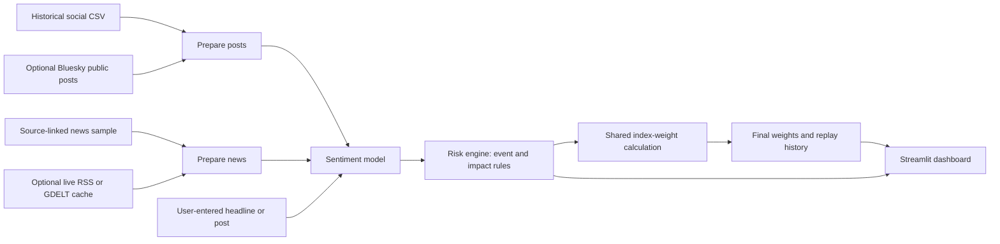

# Sentiment-driven Mock Index - S&P Global & Crisil Campus Hackathon

**Candidate Name:** Parth Chourasia

**College Email ID:** f20230824@goa.bits-pilani.ac.in

**College / Campus:** BITS Pilani, K. K. Birla Goa Campus

**Demo Video Link:** [Watch the YouTube demo](https://youtu.be/BTLj4hiOFAA)

**Slide Deck Link:** [Presentation PowerPoint](docs/presentation.pptx)

## 1. Project Overview / Problem Statement & Approach

Financial news and social posts contain company information in free-form text. Reviewing these sources manually makes it difficult to consistently identify the company concerned, the event discussed, and the direction of sentiment. This prototype converts such text into structured signals that can be inspected and used by a downstream financial application.

This project analyzes financial news and public social posts to identify risks affecting companies. The risk engine produces a sentiment score, event category, and impact score for each item. Module A uses sentiment to adjust the weights of a mock stock index and show the changes over simulation steps.

The chosen downstream application is Module A: sentiment-based mock index rebalancing. The reproducible default uses historical public data, while optional ingestion scripts collect current news and social posts. The dashboard supports both replay inspection and analysis of one user-entered item.

## 2. Architecture & Tech Stack



### Tech stack

- Python 3.11 for ingestion, preparation, scoring and portfolio calculations.
- scikit-learn for TF-IDF features and logistic regression sentiment classification.
- joblib for saving the locally trained model.
- Streamlit for the interactive dashboard; pandas and Altair for tables and charts.
- CSV and JSONL files for inputs and generated outputs; no database is required.
- Python unittest for core event, social-filter and portfolio checks.

### Implemented components

- `data/index.csv` defines a mock index of ten stocks with equal starting weights.
- `src/ingest_news.py` fetches recent GDELT article metadata. GDELT may rate limit requests; the script can use a locally saved response.
- `src/ingest_rss.py` optionally fetches current headlines from five official company newsroom feeds. `src/prepare_news.py` keeps only headlines that explicitly name their issuing company.
- `src/ingest_bluesky.py` optionally fetches recent public social posts through Bluesky search. A post must contain exactly one cashtag and explicitly name that company to enter the prepared dataset.
- `data/news_seed.csv` contains ten short, paraphrased, source-linked public news and release items for a reproducible demo. `src/prepare_news.py` uses this sample by default; `--include-cached` explicitly adds local GDELT and RSS headlines.
- `src/prepare_posts.py` selects historical social posts with explicit `$TICKER` mentions by default; `--include-cached` adds the optional live Bluesky cache. This conservative match avoids treating an analyst's company as the subject of a post.
- `src/train_sentiment.py` trains a TF-IDF and logistic regression sentiment baseline, evaluates it on held-out posts, and scores both social and news inputs.
- `src/risk_engine.py` combines scored inputs and adds a rule-based event type and potential-impact score.
- `src/portfolio.py` contains the shared index-weight calculation used by `src/rebalance.py`, `src/rebalance_history.py`, and the interactive dashboard.
- `src/rebalance.py` uses sentiment from structured signals with a recognized event type to adjust a mock index and writes `data/rebalanced_index.csv`.
- `src/rebalance_history.py` replays scored posts as simulation steps and writes `data/weight_history.csv`.
- `app.py` displays the changing weights and the final index in a Streamlit dashboard. It also accepts one new headline or post for a temporary what-if analysis.

## 3. Dataset Used

The social data comes from the [Twitter Financial News Sentiment dataset](https://huggingface.co/datasets/zeroshot/twitter-financial-news-sentiment) (MIT license). `data/social_train.csv` is the training split and `data/social_posts.csv` is the validation split, replayed as historical posts rather than live social data. The dataset maps 0 to bearish, 1 to bullish, and 2 to neutral. Before training, the script excludes training rows whose cleaned text also appears in validation. The news sample is historical too. Its CSV includes a direct public source URL for every paraphrased headline.

### Data assumptions

- `data/index.csv` is a synthetic portfolio of ten real company tickers, each starting at 10%; it does not reproduce an official S&P index.
- `data/news_seed.csv` contains ten paraphrased public items with their source URLs. It is a small demonstration sample, not a representative news evaluation set.
- The default run prepares 14 historical social records and ten news records. No confidential client data is used.
- Historical posts lack reliable event timestamps; replay order is file order, not market chronology. The default run does not continuously poll live sources.

### Optional current sources

For an optional current-data run, use `python3 src/ingest_bluesky.py` and `python3 src/ingest_rss.py` first. Then run `python3 src/prepare_posts.py --include-cached` and `python3 src/prepare_news.py --include-cached`, followed by the training, risk-engine, rebalance, and dashboard commands above. The [Bluesky search API](https://docs.bsky.app/docs/api/app-bsky-feed-search-posts) provides public posts; single-cashtag plus company-name filtering reduces unrelated results but also misses some relevant posts. These posts are not independently verified. The newsroom feeds cover Apple, Microsoft, Amazon, Google, and Meta and contain company announcements, not independent reporting. The caches are local and not committed. `src/ingest_news.py` remains an optional GDELT path; [GDELT's DOC API](https://blog.gdeltproject.org/gdelt-doc-2-0-api-debuts/) may return HTTP 429. The curated sample works without any live source.

## 4. Quickstart & Installation

### Docker quickstart

Install [Docker Desktop](https://docs.docker.com/get-started/get-docker/) (or Docker Engine with the Compose plugin). Clone the repository and run:

```bash
git clone https://github.com/f20230824-bot/BITS_Goa-Parth_Chourasia_hackathon.git
cd BITS_Goa-Parth_Chourasia_hackathon
docker compose up --build
```

Open http://localhost:8501. The first build installs the pinned dependencies, runs the complete default pipeline, and runs the core tests. The image contains the generated model and replay data; running it does not require live feeds, API keys, or a local Python installation. Building requires internet access to download the base image and Python packages. Press Control+C to stop; `docker compose down` removes the stopped container. If port 8501 is already in use, stop the locally running dashboard first.

Without Compose:

```bash
docker build -t mock-index .
docker run --rm -p 127.0.0.1:8501:8501 mock-index
```

The container serves the dashboard as an unprivileged user and provides an HTTP health check. Its build context includes only application code, tests, and the four tracked input CSVs. Optional live caches, local model files, credentials, and Git history are excluded.

Verified locally with Docker Desktop on macOS (Apple Silicon): the image builds, the demo pipeline runs, all 9 tests pass, the dashboard health endpoint responds, and the dashboard renders and analyzes a new text item successfully. The `Docker smoke test` GitHub Actions workflow also builds the image and checks the running dashboard after a push.

### Local Python quickstart

**Runtime:** Python 3.11; tested on macOS using Python 3.11.8.

Use Python 3.11. Check `python3 --version` first and select a Python 3.11 interpreter if your system default is older. From a terminal, run:

```bash
git clone https://github.com/f20230824-bot/BITS_Goa-Parth_Chourasia_hackathon.git
cd BITS_Goa-Parth_Chourasia_hackathon
python3 -m pip install -r requirements.txt
python3 src/prepare_posts.py
python3 src/prepare_news.py
python3 src/train_sentiment.py
python3 src/risk_engine.py
python3 src/rebalance.py
python3 src/rebalance_history.py
python3 -m unittest discover -s tests
python3 -m streamlit run app.py
```

The training command writes `data/social_signals.jsonl`, `data/news_signals.jsonl`, and a local `data/sentiment_model.joblib` used by the dashboard form. Generated artifacts are ignored by Git and recreated by the commands above. Each record includes a sentiment label and a score from -1 to 1, calculated as `P(bullish) - P(bearish)`. The model does not read the source sentiment labels when scoring social records. The validation result below applies to social posts only; news-headline accuracy has not been measured.

The risk engine writes `data/risk_signals.jsonl` with source, ticker, text, sentiment, event type, matched phrase, and a 1–10 impact score. Event categories use ordered keyword rules. The impact score starts from a fixed event-category severity and rises by at most two points for stronger sentiment. `Other/Unclear` receives 1. These are explicit prototype assumptions, not market-calibrated predictions. The dashboard displays the unified output and its source links.

The rebalancer writes `data/rebalanced_index.csv`. It uses recognized-event signals from both news and social inputs, excluding `Other/Unclear`. It transfers weight from stocks with negative average sentiment to stocks with positive average sentiment, in proportion to their desired changes. Stocks with no eligible signal keep their starting weight. If all available signals have the same sign, it makes no transfer because there is no opposite side to fund it. The `alpha = 0.2` sensitivity is a simulation assumption, not an estimated market effect. The dashboard form uses this same calculation on the saved signals plus one entered item; it does not save the entered text or alter the baseline files.

The history script writes one index snapshot before any eligible signal and one after each additional signal. Historical social posts lack timestamps and the two sources are replayed in file order, so the dashboard's horizontal axis represents simulation steps rather than real time.

Open http://localhost:8501 after Streamlit starts. Keep the terminal running; press Control+C to stop the dashboard.

## 5. Key Results & Domain Impact

On the 2,388-row validation file, this baseline reached 0.802 accuracy and 0.744 macro F1 after excluding 68 overlapping training rows. These are sentiment classification results, not evidence of profitable index rebalancing.

### Prototype outputs and domain use

The default pipeline produces 24 structured risk signals, a final ten-stock allocation, and 14 index snapshots (140 history rows) using 13 signals with recognized event types. The dashboard shows source provenance, sentiment, event and impact fields, and changing weights. A user can also enter a headline or post to inspect a temporary what-if allocation.

This demonstrates how an analyst could move from scattered text to traceable company signals and inspect their effect on a mock allocation. Source links and matched event phrases support review. The prototype illustrates a financial monitoring workflow; it does not demonstrate investment returns or production trading performance.

### Verification and limitations

Nine core tests passed. The full default pipeline and dashboard form were also verified from a clean repository checkout using the existing Python 3.11 environment.

A [20-signal manual review](docs/signal_review.md) found four clear event-label errors, which were used to tighten the event rules. It is a small sanity check, not a measured event-classification accuracy or an evaluation of the sentiment model on news headlines.

The prototype still needs broader evaluation of news sentiment, event classification, and impact scoring, plus stronger company attribution for ambiguous multi-ticker posts. Live GDELT coverage is rate-limited and its cached response can be noisy. Official newsroom feeds cover five of the ten index companies, and many headlines describe products or marketing rather than material financial events. Bluesky coverage varies by ticker and can include unverified claims. The source-linked samples support a reproducible demo.
